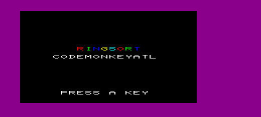
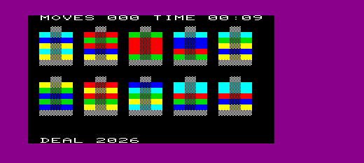
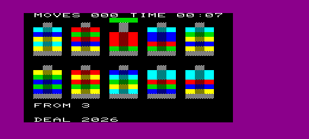
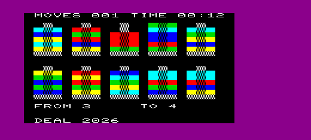
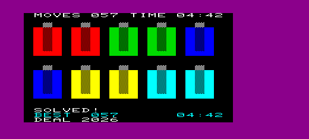
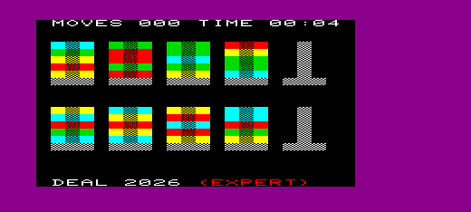

# ringsort

A color-sorting ring puzzle for the **unexpanded VIC-20**, written in Commodore BASIC V2.

Rings are shuffled onto ten posts. Move them one at a time until every post holds five rings of a single color. Three modes: **classic**, **hard** and **expert**.

## features

- three modes: classic (50 rings in 5 colors, any color on any), hard (40 rings in 4 colors, two empty posts, same color only) and expert (as hard, but posts hold only five rings)
- one-key controls: a post's number lifts a ring, another post's number drops it
- each post holds up to six rings; the sixth slot is the room you need to move
- a post that holds five rings of one color locks, so a finished set can't be undone by accident; its base turns solid in the ring color and a ding-ding plays
- a move readout (`FROM 1 … TO 2`, `MOVE CANCELED`) plus "invalid move" and "solved!" messages
- a live score on the top row: moves and a running timer, plus the session's best moves and best time for each mode
- a splash screen; its keypress seeds the shuffle, so every launch gets a different board
- deal numbers: every board has a number (1-99999) shown at the bottom; type it in after `n` to replay a board or share it with a friend
- a flickering color block shows the shuffle at work while dealing
- sound effects: dealing chatter, ring up and down, an invalid-move buzz, a cancel woosh, a lock ding-ding and a win chime
- runs on a stock VIC-20 with no memory expansion

## how to play

On the title screen, press `h` for hard, `e` for expert, or any other key for classic.

| Key | Action |
|---|---|
| `1`-`9`, `0` | select post 1-9, or post 10 with `0` |
| space | put the lifted ring back |
| `n` | new game: asks `c/h/e` for the mode (any other key cancels), then a deal number (Return alone = random deal) |
| `r` | redraw the screen |
| `q` | quit |

**Moving a ring:**
- Press a post's key: its top ring lifts above the post.
- Press another post's key: the ring drops onto that post. In classic, any color can go on any color; in hard and expert, only onto the same color or an empty post.
- To cancel, press the same post again or space.

**Rules:**
- A post holds at most six rings (five in expert). Dropping onto a full post or a different color (hard, expert), or lifting from an empty one, shows "invalid move".
- A post with exactly five rings of one color is **locked**, and its base turns from the white checker to solid in the ring color. You can't lift from it, but you can park one extra ring on top and lift that ring off again later; the base stays solid while it's parked.

**Winning:** every post is locked (five rings of one color each) or empty.

**Modes:**

| Mode | Rings | Start | Rule |
|---|---|---|---|
| classic | 50 in 5 colors | every post full | any color on any color; posts hold 6 |
| hard | 40 in 4 colors (no blue) | posts 5 and 10 empty | same color or an empty post only; posts hold 6 |
| expert | as hard | as hard | as hard, but posts hold only 5: no cap slot (none is drawn) |

Every hard and expert deal we tested with a solver could be won. Hard is forgiving; in expert it's much easier to paint yourself into a corner.

**Score:** the top row counts your moves (each ring dropped onto another post) and the time since the board was dealt. The clock stops when you win, or at 99:59. Your best moves and best time this session (for the mode you're playing) show at the bottom in cyan; try to beat them.

## screenshots

The splash screen. The key you press here picks the mode and seeds the shuffle.



A classic deal (deal 2026): ten posts, five shuffled rings each. The checkered pole top above each post is the sixth slot. The top row shows the moves and the time, the bottom row the deal number.



Pressing `3` lifts post 3's top ring (green) above the post. In the air it's solid: the post no longer runs through it.



Pressing `4` drops it onto post 4. Post 4 was full with five rings, so the green ring goes into its sixth slot, and post 3 is left with four. The move counter goes to 001.



A solved board: every post holds five rings of one color, and each base has turned solid. The session's best moves and time appear in cyan.



The same deal number in hard mode: 40 rings in four colors, with posts 5 and 10 empty. A ring may only go onto the same color or an empty post.


Expert mode deals the same board as hard, but posts hold only five rings, so there's no cap slot to park a ring in.



## compatibility

- Unexpanded VIC-20 (3583 bytes free for BASIC). Not yet tested with RAM expansion.
- Tested in VICE 3.10 (xvic).

## repository layout

```
src/
  ringsort.bas       the game
  prototype.bas      early hard-coded drawing prototype
  randomcolors.bas   early shuffle experiment

prgs/
  (.prg files built by the GitHub Action)

docs/
  design.md            how the program works: data model, routines, variables, memory
  basic-guidelines.md  how we write BASIC for the unexpanded VIC-20
  cheatsheet.md        petcat tokens, VIC-20 color codes and registers

screenshots/
  images used in this README (temp/ holds working captures and is gitignored)

tools/
  petcat, petcat.exe   petcat for Linux (CI) and Windows (local builds)
  c1541, c1541.exe     c1541 for making disk images

buildtools/
  build-and-run.ps1  local build: check, petcat the current .bas, then autostart it in xvic
  check-basic.ps1    lint a .bas file against docs/basic-guidelines.md (warnings only)
  screenshot.ps1     save the running xvic screen to screenshots/temp/ (gitignored)
  tasks.vs.json      Visual Studio task (copy to .vs/tasks.vs.json)
  tasks.json         VS Code task (copy to .vscode/tasks.json)

.github/workflows/
  build-prg.yml      builds .prg files when a pull request is merged
```

## building

The `.prg` is generated with `petcat`. The repository includes Linux and Windows versions in `tools/`.

```
petcat -w2 -l 1001 -o prgs/ringsort src/ringsort.bas
```

### build and run from the IDE

`buildtools/build-and-run.ps1` checks the open `.bas` file with `check-basic.ps1`, builds it into `prgs/` and autostarts it in xvic. The check prints warnings (missing jump targets, lines too long to edit on the VIC, stray spaces, line-number problems) but never stops the build. If xvic is already running with its remote monitor on port 6510, the program is sent to that window; otherwise a new xvic is started with `-remotemonitor`. `petcat.exe` and `xvic.exe` must be on your `PATH`.

The IDE config folders are gitignored, so copy the task file into place once:

- Visual Studio (Open Folder): copy `buildtools/tasks.vs.json` to `.vs/tasks.vs.json`, then Build with a `.bas` file active.
- VS Code: copy `buildtools/tasks.json` to `.vscode/tasks.json`, then run the default build task.

## running

### in VICE

```
xvic -memory none -autostart prgs/ringsort
```

or load it from the BASIC prompt:

```
load "ringsort",8
run
```

### on real hardware

Copy the PRG to a disk image or transfer it with your preferred method (SD2IEC, Pi1541, etc.). No RAM expansion is needed.

## automatic build

When a pull request that changes any `.bas` file is merged (or a `v*` tag is pushed), the GitHub Action in `.github/workflows/build-prg.yml`:

- runs the repository's `tools/petcat` on each changed `.bas` file
- writes the resulting `.prg` files to `prgs/`
- commits them to `main`, naming the pull request or tag in the commit message

This keeps the PRGs in sync with the BASIC source without installing the full VICE package.

## license

This project is released under the MIT License. See the `LICENSE` file for details.
